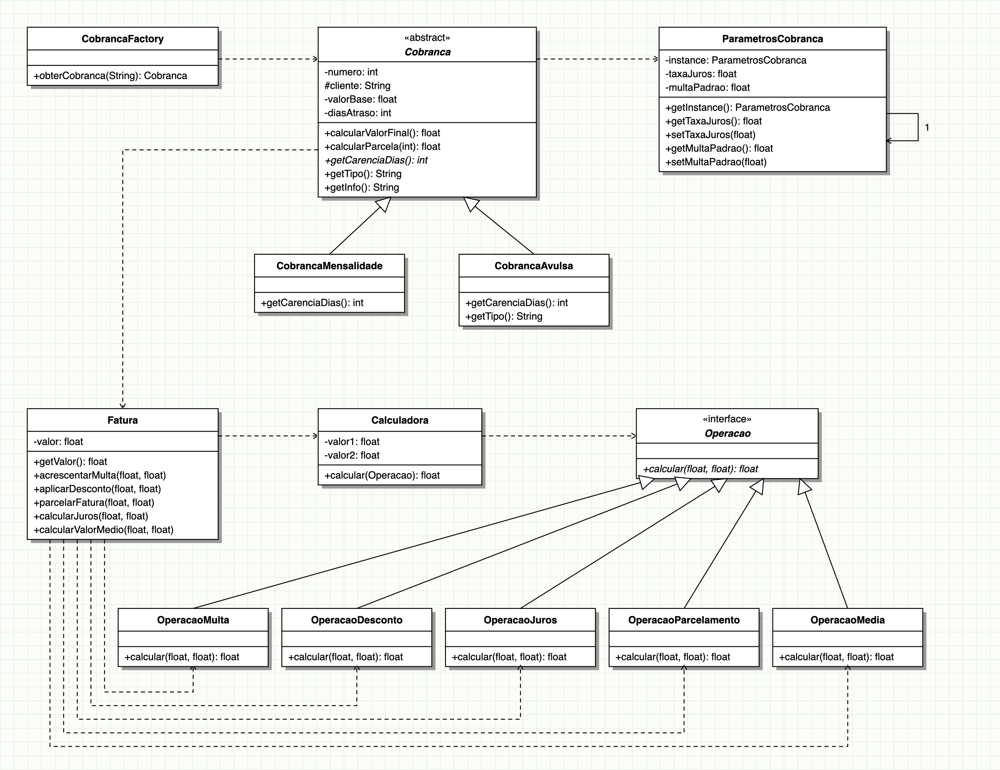

# Strategy + Factory Method + Template Method + Singleton — Cobrança de Faturas

Integração dos padrões **Strategy**, **Factory Method**, **Template Method** e **Singleton** em um sistema de cobrança de faturas.

## Diagrama UML



Versão editável em Mermaid: [docs/diagrama-uml.md](docs/diagrama-uml.md).

## Como rodar os testes

```
mvn test
```
